  
  
  
  
  
  



<a href="https://github.com/RejwanShafi25/RejBoard"></a>

  
  
  

<a href="https://github.com/RejwanShafi25/RSWNet"></a>

  

<a href="https://github.com/RejwanShafi25/Nilam-an-online-auction-system"></a>

  

<a href="https://github.com/RejwanShafi25/Signboard-Detection-Using-YOLO-V8-main"></a>

  


  
  
  
  
  



<!--
  PORTRAIT GALLERY: drop your paintings into assets/art/ (JPG or PNG, similar aspect ratio)
  and uncomment this block. Each image links to the full-size file.

  
  
  

-->

  <a href="https://instagram.com/bd_sketch25"></a>
  <a href="https://www.behance.net/bd_sketch25"></a>
  



  


  
  <a href="https://www.linkedin.com/in/rejwanshafi/"></a>

